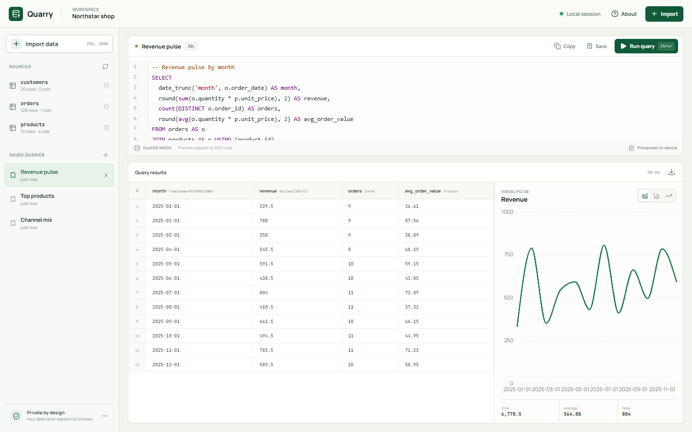
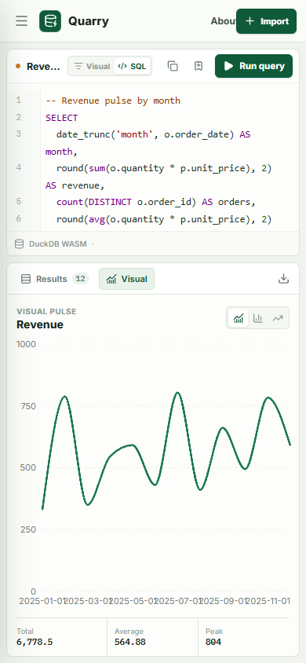
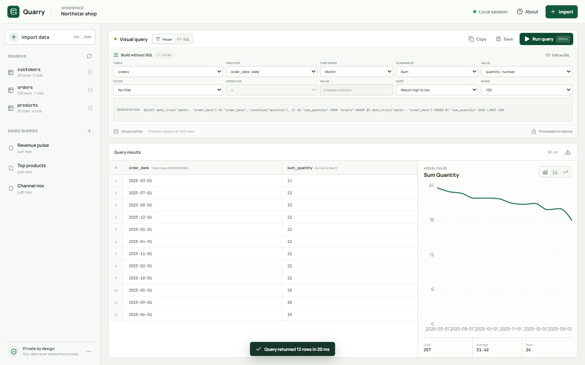
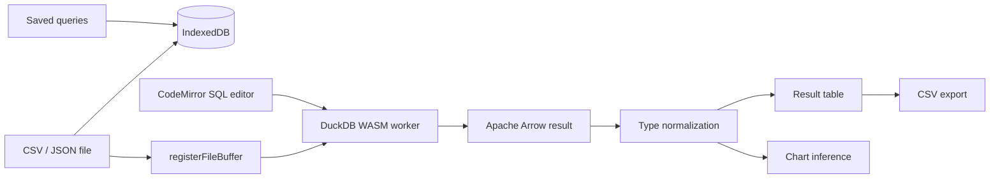

# Quarry

**A private, local-first SQL workbench for CSV and JSON files.**

Quarry turns raw files into queryable tables, charts, and exportable results without sending the data to a backend. DuckDB WebAssembly runs the SQL engine directly in the browser, while React handles the editing and analysis experience.

[Live demo](https://kyo-saber.github.io/quarry-data-workbench/) · [Architecture](#architecture) · [Run locally](#run-locally)

[](https://github.com/kyo-saber/quarry-data-workbench/actions/workflows/ci.yml)
[](https://github.com/kyo-saber/quarry-data-workbench/actions/workflows/deploy-pages.yml)



## Why Quarry

Most CSV viewers are either too basic for real analysis or require uploading sensitive files to an unknown server. Quarry sits in the middle: it is approachable enough for quick exploration and capable enough for joins, grouping, CTEs, window functions, and other analytical SQL.

It is also a focused demonstration of browser-native data engineering:

- DuckDB WebAssembly runs real OLAP SQL in a Web Worker.
- CSV, TSV, JSON, JSONL, and NDJSON files are imported locally.
- Imported files and saved queries persist in IndexedDB.
- Arrow values are normalized for decimal, timestamp, bigint, and null edge cases.
- A visual query builder covers tables, grouping, aggregations, filters, sorting, and limits.
- Generated SQL remains visible and can be opened in the full SQL editor at any time.
- Results can be inspected as a table, explored as an auto-inferred chart, or exported to CSV.
- The app includes a working sample warehouse and mobile layout, not just a landing page.

## Product Walkthrough

The starter workspace contains a small commerce dataset with `orders`, `products`, and `customers` tables. It opens with a monthly revenue query and an inferred line chart.

You can also import the included [`public/sample-campaign.csv`](public/sample-campaign.csv) or any file you own. After import, Quarry creates a table, previews its rows, and refreshes the source list.



The visual mode gives non-SQL users a complete first path through the product. Every control maps to a generated SQL query, which can be inspected and edited in SQL mode.



## Architecture



### Privacy model

Quarry does not have an application server, analytics SDK, account system, or query API. Source files are processed by the browser's DuckDB worker. Imported buffers and saved SQL live in the origin's IndexedDB storage and can be removed from the source list.

The app bundles its fonts and DuckDB WebAssembly engines with the static build. After the initial static asset download, the workspace can continue functioning without a network request for user data.

## Stack

- React 19 and TypeScript
- Vite
- DuckDB WebAssembly and Apache Arrow
- CodeMirror 6 for SQL editing
- Recharts for lightweight charting
- idb-keyval for local persistence
- Vitest for logic tests
- Playwright for end-to-end browser tests

## Run Locally

Requirements: Node.js 22 or newer and pnpm 11.

```bash
pnpm install
pnpm dev
```

Open `http://localhost:5173`.

### Useful commands

| Command | Purpose |
| --- | --- |
| `pnpm dev` | Start the Vite development server |
| `pnpm build` | Type-check and create the static production build |
| `pnpm test` | Run deterministic unit tests |
| `pnpm test:e2e` | Run Playwright browser tests |
| `pnpm lint` | Run Oxlint |

On Windows, the local Playwright configuration uses Microsoft Edge. CI installs Chromium and runs the same suite headlessly.

## Engineering Notes

**Browser SQL without a backend.** The query engine uses DuckDB's async WebAssembly worker and converts Arrow records into renderable cells. Decimal scale and timestamp units need explicit handling; otherwise values such as `614.00` can appear as byte buffers or be off by a power of ten.

**Persistence without detached buffers.** DuckDB transfers registered file buffers to its worker. Quarry passes a copy when importing so the original bytes remain available for IndexedDB persistence and page reloads.

**Responsive desktop workspace.** The desktop view shows the table and visual side by side. Below 900px, the sidebar becomes a drawer and the result pane exposes table and visual tabs. Playwright checks for viewport overflow at 390px.

**Progressive query authoring.** The visual builder and SQL editor share the same generated query state. Users can start with table, field, aggregation, and filter controls, then switch into SQL without losing their work.

**Small deterministic core.** SQL naming, CSV serialization, chart inference, and formatting are pure functions with unit coverage. Browser interactions, local persistence, imports, saved queries, and mobile layout are covered by end-to-end tests.

## Deployment

The repository includes a GitHub Pages workflow. In repository settings, set **Pages > Build and deployment > Source** to **GitHub Actions**, then push to `main`.

No environment variables or backend services are required.

## Roadmap

- Add file drag-and-drop with column type overrides.
- Expand source persistence to DuckDB's OPFS database.
- Add query history and saved result snapshots.
- Support Parquet and Excel imports.
- Add chart image downloads and selected-column exports.

## License

MIT. See [LICENSE](LICENSE).
